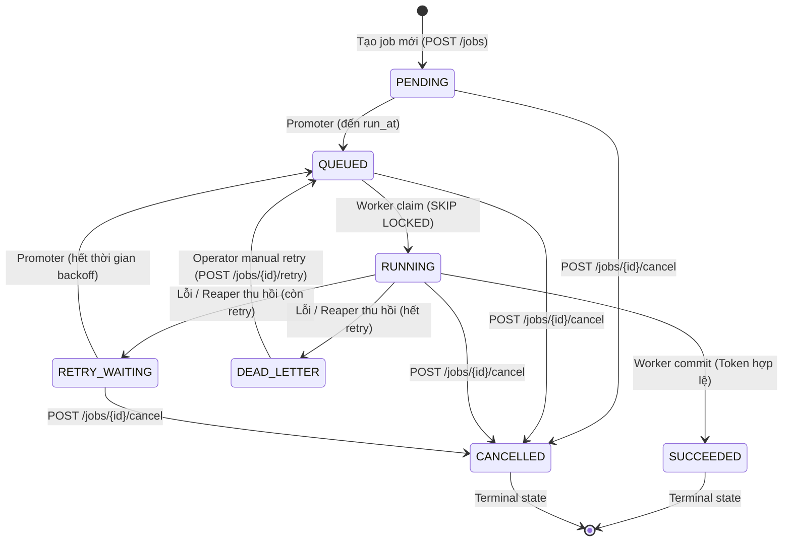

# LeaseFlow

> **Distributed Job Scheduler chịu lỗi bằng Python, PostgreSQL, Leases và Monotonic Fencing Tokens.**

[](https://www.python.org/downloads/)
[](tests/)
[](https://github.com/astral-sh/ruff)
[](https://mypy-lang.org/)

LeaseFlow là hệ thống lập lịch và phân phối công việc phân tán chịu lỗi (fault-tolerant distributed job scheduler) được thiết kế để giải quyết triệt để các bài toán khó nhất trong điện toán phân tán: Worker chết đột ngột (`kill -9`), Worker thây ma (Zombie Worker do GC pause / network split), bão retry (retry storms), và tác dụng phụ bị nhân đôi (duplicate side-effects).

---

## 5 Tính Chất Cốt Lõi (Core Guarantees)

Mọi cam kết của LeaseFlow đều được **chứng minh bằng kiểm thử tự động**, không chỉ bằng lý thuyết:

| # | Tính chất | Cơ chế đảm bảo | Cách chứng minh thực nghiệm |
|:---:|:---|:---|:---|
| **G1** | **Không mất job** | Lease TTL + Reaper định kỳ quét thu hồi | Test `SIGKILL` worker thật, job được worker khác nhận lại sau $\le TTL + T_{reaper}$. |
| **G2** | **Không ghi đè kép** | Monotonic Fencing Token đơn điệu | Test Zombie Worker (`SIGSTOP` & `SIGCONT`), mọi stale commit bị từ chối (`REJECTED_STALE`). |
| **G3** | **Không retry vô hạn** | Exponential Backoff với Full Jitter + DLQ | Test poison pill, tự động dừng retry và đưa vào Dead-Letter Queue sau `max_retries`. |
| **G4** | **Minh bạch trạng thái** | State machine $7 \times 7$ + bảng `executions` | 100% lần thử được ghi vết chi tiết (worker_id, attempt, outcome, token). |
| **G5** | **Idempotent Side-Effects** | Idempotency Key + Transactional Outbox | Khi worker sập nguồn trước khi commit, 0 side-effect nào lọt ra ngoài. |

---

## Sơ Đồ Kiến Trúc (Architecture Overview)

```mermaid
flowchart TB
    subgraph Clients["Clients & Operators"]
        API_CLIENT["REST API Client"]
        ADMIN["Operator (DLQ Retry)"]
    end

    subgraph API_Tier["FastAPI Layer"]
        API["Job Endpoints & /metrics Scrape"]
    end

    subgraph Storage["PostgreSQL 16 (Single Source of Truth)"]
        T_JOBS[("jobs table\nPartial Index: status='QUEUED'")]
        T_EXEC[("executions table\nAudit trail for attempts")]
        T_OUTBOX[("outbox table\nAtomic side-effect queue")]
    end

    subgraph Control_Plane["Scheduler & Control Plane"]
        PROMOTER["Promoter Loop\n(PENDING / RETRY_WAITING -> QUEUED)"]
        REAPER["Reaper Loop\n(Quét Lease Expired & Timed Out)"]
        DISPATCHER["Outbox Dispatcher\n(FOR UPDATE SKIP LOCKED)"]
    end

    subgraph Workers["Distributed Worker Fleet"]
        W1["Worker 1 (Async Runtime)"]
        W2["Worker 2 (Async Runtime)"]
        WN["Worker N..."]
    end

    API_CLIENT -->|POST /jobs| API
    ADMIN -->|POST /jobs/{id}/retry| API
    API --> Storage

    PROMOTER -->|Promote due jobs| T_JOBS
    REAPER -->|Reclaim expired leases| T_JOBS
    REAPER -->|Record LEASE_EXPIRED| T_EXEC
    DISPATCHER -->|Deliver side-effects| T_OUTBOX

    W1 -->|SELECT FOR UPDATE SKIP LOCKED| T_JOBS
    W2 -->|SELECT FOR UPDATE SKIP LOCKED| T_JOBS
    WN -->|SELECT FOR UPDATE SKIP LOCKED| T_JOBS

    W1 -.->|Independent Heartbeat| T_JOBS
    W2 -.->|Independent Heartbeat| T_JOBS
```

---

## Máy Trạng Thái Công Việc (Job State Machine)



---

## Bắt Đầu Nhanh (Quickstart)

### 1. Cài đặt môi trường
Yêu cầu Python >= 3.11 và package manager [uv](https://docs.astral.sh/uv/):
```bash
# Cài đặt toàn bộ dependencies và môi trường ảo
uv sync
```

### 2. Chạy Chaos Demo Tự Động (`make demo`)
Chạy kịch bản demo sống động tái hiện toàn bộ 5 tính chất cốt lõi:
```bash
# Tự động kết nối PostgreSQL hoặc chạy SQLite WAL độc lập không cần setup
make demo
# hoặc: uv run python scripts/demo.py
```
*Kịch bản mô phỏng: Gửi 10 jobs outbox $\to$ `SIGKILL` Worker 1 $\to$ Reaper tự động phục hồi $\to$ `SIGSTOP` & `SIGCONT` Zombie Worker 3 $\to$ Fencing Token từ chối ghi đè $\to$ Exponential Backoff & DLQ $\to$ Operator Manual Retry $\to$ In bảng kiểm toán.*

### 3. Chạy Performance Benchmark Suite (`make bench`)
```bash
# Đo đạc thông lượng, độ trễ phân vị p50/p95/p99, SKIP LOCKED và recovery time
make bench
# hoặc: uv run python scripts/bench.py
```
*Kết quả tự động được cập nhật vào [docs/benchmark-results.md](file:///c:/Python/leaseflow/docs/benchmark-results.md).*

### 4. Chạy Toàn Bộ Test Suite (84 Tests)
```bash
# Chạy 84 tests (Unit, Integration, Concurrency, Chaos, Property-Based)
uv run pytest -v

# Chạy kiểm thử bất biến phân tán (Hypothesis State Machine)
uv run pytest tests/property/test_stateful_invariants.py -v

# Chạy chaos test (SIGKILL recovery, zombie pause, network partition)
uv run pytest tests/chaos/ -v

# Kiểm tra chất lượng mã nguồn (Strict Type Check & Lint)
uv run ruff check .
uv run mypy app
```

---

## Tài Liệu Kỹ Thuật Chuyên Sâu

- 📐 [**Kiến Trúc Hệ Thống (docs/architecture.md)**](file:///c:/Python/leaseflow/docs/architecture.md): Phân tích chi tiết từng phân hệ, mô hình dữ liệu, index design, cơ chế deterministic clock.
- 🐛 [**Những Bug Tôi Gặp (docs/failure-report.md)**](file:///c:/Python/leaseflow/docs/failure-report.md): Bài viết kỹ thuật chuyên sâu ghi lại các lỗi đua tranh thực tế, dual-write problem, lock contention, và cách giải quyết.
- 📊 [**Báo Cáo Benchmark (docs/benchmark-results.md)**](file:///c:/Python/leaseflow/docs/benchmark-results.md): Số liệu thực nghiệm về thông lượng, độ trễ và thời gian phục hồi.
- 🛡️ [**Tài Liệu Bảo Đảm Idempotency (docs/guarantees-idempotency.md)**](file:///c:/Python/leaseflow/docs/guarantees-idempotency.md): Cam kết tác dụng phụ an toàn với Transactional Outbox.
- 📝 [**Nhật Ký Phát Triển (docs/devlog.md)**](file:///c:/Python/leaseflow/docs/devlog.md): Tiến trình thực hiện từng Phase.
- 📦 [**Lịch Sử Phát Hành (CHANGELOG.md)**](file:///c:/Python/leaseflow/CHANGELOG.md): Thay đổi chi tiết chuẩn Keep a Changelog cho v0.1.0.

---

## Tiến Độ Dự Án (Roadmap & Status)

- [x] **Phase 0: Nền tảng dự án**: Docker Compose, Alembic, CI GitHub Actions, ADR 1-6, Clock deterministic, Pyproject.
- [x] **Phase 1: Job CRUD & State Machine**: State machine chuyển trạng thái nghiêm ngặt ($7 \times 7$), Models, Repository, REST API.
- [x] **Phase 2: Safe Claim & Worker Runtime**: Promoter (`PENDING -> QUEUED`), `PostgresQueueBackend` với `SELECT ... FOR UPDATE SKIP LOCKED`, `Worker` loop hỗ trợ async & sync handlers qua ThreadPoolExecutor, Concurrency Claim Tests (20 workers cùng đua 500 jobs - 0 duplicate claim, 0 lost jobs).
- [x] **Phase 3: Lease, Heartbeat & Reaper**: Lease heartbeat gia hạn độc lập, Reaper thu hồi lease quá hạn / timeout.
- [x] **Phase 4: Fencing Token Enforcement**: Ngăn chặn hoàn toàn zombie worker ghi đè kết quả với `fencing_token`.
- [x] **Phase 5: Exponential Backoff, Jitter & DLQ**: Chiến lược retry tất định với full jitter, phân loại lỗi retryable/non-retryable, API thủ công `/jobs/{id}/retry`, `/dead-letters`, bảo đảm Core Guarantee G3.
- [x] **Phase 6: Transactional Outbox Pattern**: Bảo đảm tính toàn vẹn tác dụng phụ (side-effects), commit nguyên tử job + outbox trong một transaction, OutboxDispatcher với `FOR UPDATE SKIP LOCKED`, tài liệu hóa cam kết G5.
- [x] **Phase 7: Observability**: 12 Prometheus metrics chuẩn hoá (latency histograms, throughput counters, queue depth gauges, zombie rejection & lease expiration counters), structured JSON logging với correlation contextvars (`job_id`, `worker_id`, `fencing_token`, `attempt`), `/metrics` scrape endpoint cập nhật thời gian thực, cấu hình Grafana provisioning tự động và dashboard chuyên sâu `leaseflow-overview.json`.
- [x] **Phase 8: Chaos Engineering & Property Testing**: Process-level chaos harness (`SIGKILL`, `SIGSTOP`/`SIGCONT`), fault injection proxy (network latency & transient drops), kiểm thử bất biến phân tán với Hypothesis `RuleBasedStateMachine` (8 bất biến kiểm tra liên tục), và soak testing script (`scripts/soak_test.py`) chịu tải chaos liên tục.
- [x] **Phase 9: Demo, Benchmark & Hoàn Thiện Tài Liệu**: Kịch bản demo tự động (`make demo`), hệ thống benchmark đa tiêu chí (`make bench`), báo cáo hiệu năng thực nghiệm, tài liệu thiết kế kiến trúc và bài viết chuyên sâu "Những bug tôi gặp".
- [x] **Phase 10: Hoàn Thiện MVP & Phát Hành v0.1**: Rà soát bảo mật cơ bản (API Key authentication với timing attack protection, regex validation, payload size limit 1MB), đóng gói Docker multi-stage & Compose hoàn chỉnh, phát hành v0.1.0 và CHANGELOG.
