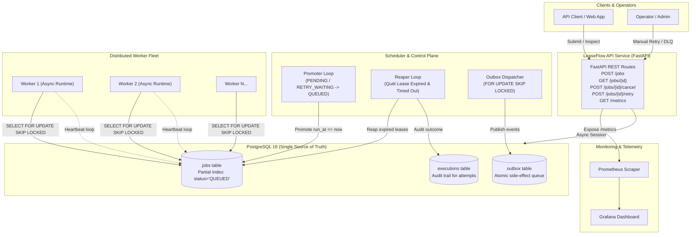
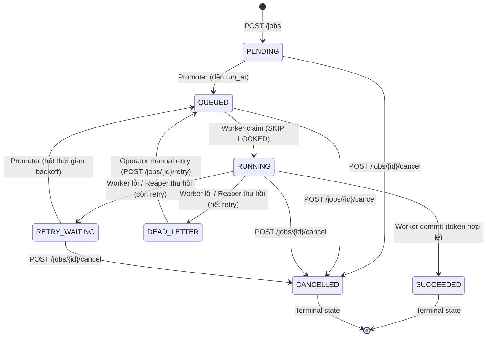

# Kiến Trúc Hệ Thống LeaseFlow

> **Distributed Job Scheduler chịu lỗi bằng Python, PostgreSQL, Leases và Monotonic Fencing Tokens.**

---

## 1. Tổng Quan & 5 Cam Kết Cốt Lõi (Core Guarantees)

LeaseFlow được thiết kế giải quyết triệt để các bài toán hóc búa nhất trong các hệ thống phân tán: Worker chết đột ngột (`kill -9`), hiện tượng Worker "thây ma" (Zombie Worker do GC pause hoặc network partition), bão retry (retry storm), và tác dụng phụ bị trùng lặp (duplicate side-effects).

| Cam kết | Tên tính chất | Cơ chế bảo đảm kỹ thuật |
|:-------:|:--------------|:------------------------|
| **G1** | **Không mất job** | Lease TTL + Reaper định kỳ quét và thu hồi job của worker chết. |
| **G2** | **Không ghi đè kép** | Monotonic Fencing Token đơn điệu, từ chối mọi stale commit (`REJECTED_STALE`). |
| **G3** | **Không retry vô hạn** | Exponential Backoff kết hợp Full Jitter + Dead-Letter Queue (DLQ). |
| **G4** | **Minh bạch trạng thái** | State machine $7 \times 7$ nghiêm ngặt + bảng `executions` lưu toàn bộ lịch sử thử nghiệm. |
| **G5** | **Idempotent Side-Effects** | Idempotency Key khi tạo job + Transactional Outbox Pattern (commit nguyên tử trong 1 transaction). |

---

## 2. Sơ Đồ Kiến Trúc Tổng Thể (System Architecture)



---

## 3. Máy Trạng Thái Công Việc (Job State Machine)

LeaseFlow thực thi một ma trận chuyển đổi trạng thái thuần túy (pure domain logic) nghiêm ngặt gồm 7 trạng thái, ngăn chặn mọi bước chuyển bất hợp lệ:



### Ma trận 11 bước chuyển hợp lệ:
1. `PENDING -> QUEUED`: Do **Promoter** khi $now \ge run\_at$.
2. `PENDING -> CANCELLED`: Do **Client** hủy job trước khi chạy.
3. `QUEUED -> RUNNING`: Do **Worker** nhận việc với `SELECT ... FOR UPDATE SKIP LOCKED`.
4. `QUEUED -> CANCELLED`: Do **Client** hủy job trong hàng đợi.
5. `RUNNING -> SUCCEEDED`: Do **Worker** commit thành công kèm `fencing_token` hợp lệ.
6. `RUNNING -> RETRY_WAITING`: Do **Worker** báo lỗi hoặc **Reaper** thu hồi lease (khi $attempt < max\_retries$).
7. `RUNNING -> DEAD_LETTER`: Do **Worker** / **Reaper** khi đã chạm ngưỡng $attempt \ge max\_retries$.
8. `RUNNING -> CANCELLED`: Do **Client** hủy job đang chạy.
9. `RETRY_WAITING -> QUEUED`: Do **Promoter** khi hết thời gian ngủ backoff.
10. `RETRY_WAITING -> CANCELLED`: Do **Client** hủy job đang chờ retry.
11. `DEAD_LETTER -> QUEUED`: Do **Operator** chủ động gọi API `POST /jobs/{id}/retry`.

---

## 4. Các Phân Hệ & Cơ Chế Kỹ Thuật Chi Tiết

### 4.1. Safe Claim với `SELECT ... FOR UPDATE SKIP LOCKED`
- Worker không bao giờ bị nghẽn (lock contention) nhờ mệnh đề `SKIP LOCKED`.
- Khi 20 workers cùng đua nhận 1.000 jobs, mỗi job chỉ được cấp phát cho duy nhất 1 worker.
- Partial Index chuyên dụng:
  ```sql
  CREATE INDEX idx_jobs_queue_claim 
  ON jobs (priority DESC, run_at ASC) 
  WHERE status = 'QUEUED';
  ```
  Giúp câu lệnh claim đạt độ phức tạp **$O(1)$** bất kể độ sâu của bảng dữ liệu.

### 4.2. Tách Biệt Lease TTL và Execution Timeout (ADR-4)
- **Lease TTL (`lease_expires_at`)**: Khoảng thời gian worker phải báo cáo sự sống (mặc định 30s). Worker chạy background task gửi heartbeat định kỳ sau mỗi `TTL / 3` (10s).
- **Execution Deadline (`execution_deadline`)**: Thời gian tối đa cho 1 lần thực thi ($started\_at + timeout\_seconds$), bảo vệ hệ thống khỏi các job bị treo vòng lặp vô hạn.

### 4.3. Monotonic Fencing Tokens (ADR-3)
- Ngăn chặn hoàn toàn **Zombie Worker**: Khi Worker A bị lag hoặc suspend, Lease hết hạn và Worker B nhận lại job với `fencing_token = token + 1`.
- Khi Worker A thức dậy và cố commit, database kiểm tra:
  ```sql
  UPDATE jobs 
  SET status = 'SUCCEEDED', ...
  WHERE id = :job_id AND fencing_token = :worker_token;
  ```
  Số dòng cập nhật trả về là `0` $\to$ Giao dịch bị từ chối, ghi nhận outcome `REJECTED_STALE`.

### 4.4. Exponential Backoff với Full Jitter (ADR-5)
- Công thức tính thời gian backoff chống bão retry:
  $$T_{backoff} = \text{random}(0, \; \min(T_{max}, \; T_{base} \times 2^{attempt}))$$
- Phân loại lỗi tự động:
  - *Non-retryable errors* (Validation error, syntax error, format invalid) $\to$ Chuyển thẳng `DEAD_LETTER`.
  - *Retryable errors* (Network glitch, lock timeout, connection reset) $\to$ Backoff và retry.

### 4.5. Transactional Outbox Pattern (ADR-5, G5)
- Khi hoàn thành tác vụ có tác dụng phụ (gửi email, gọi webhook), Worker **không gọi trực tiếp external service** trong lúc transaction đang mở.
- Thay vào đó, Worker ghi các event vào bảng `outbox` **trong cùng database transaction** với lệnh commit status `SUCCEEDED` của job.
- Tiến trình `OutboxDispatcher` độc lập quét bảng `outbox` qua `FOR UPDATE SKIP LOCKED` để gửi đi và ghi nhận `dispatched_at`.
- Nếu Worker crash trước khi commit, không có bất kỳ outbox record nào lọt ra ngoài $\to$ Bảo đảm tính nhất quán tuyệt đối.

---

## 5. Lược Đồ Dữ Liệu (Database Schema)

```sql
CREATE TYPE job_status AS ENUM (
    'PENDING', 'QUEUED', 'RUNNING', 'SUCCEEDED', 
    'RETRY_WAITING', 'DEAD_LETTER', 'CANCELLED'
);

CREATE TABLE jobs (
    id UUID PRIMARY KEY,
    type VARCHAR(128) NOT NULL,
    payload JSONB NOT NULL DEFAULT '{}',
    status job_status NOT NULL DEFAULT 'PENDING',
    priority INT NOT NULL DEFAULT 0,
    run_at TIMESTAMPTZ NOT NULL DEFAULT clock_timestamp(),
    idempotency_key VARCHAR(256),
    max_retries INT NOT NULL DEFAULT 3,
    timeout_seconds INT NOT NULL DEFAULT 60,
    attempt INT NOT NULL DEFAULT 0,
    fencing_token BIGINT NOT NULL DEFAULT 0,
    lease_owner VARCHAR(128),
    lease_expires_at TIMESTAMPTZ,
    execution_deadline TIMESTAMPTZ,
    result JSONB,
    last_error TEXT,
    created_at TIMESTAMPTZ NOT NULL DEFAULT clock_timestamp(),
    updated_at TIMESTAMPTZ NOT NULL DEFAULT clock_timestamp()
);

CREATE TABLE executions (
    id UUID PRIMARY KEY,
    job_id UUID NOT NULL REFERENCES jobs(id) ON DELETE CASCADE,
    attempt INT NOT NULL,
    worker_id VARCHAR(128) NOT NULL,
    fencing_token BIGINT NOT NULL,
    started_at TIMESTAMPTZ NOT NULL DEFAULT clock_timestamp(),
    finished_at TIMESTAMPTZ,
    outcome VARCHAR(64),
    error TEXT
);

CREATE TABLE outbox (
    id UUID PRIMARY KEY,
    job_id UUID REFERENCES jobs(id) ON DELETE SET NULL,
    kind VARCHAR(128) NOT NULL,
    payload JSONB NOT NULL DEFAULT '{}',
    dedup_key VARCHAR(256),
    created_at TIMESTAMPTZ NOT NULL DEFAULT clock_timestamp(),
    dispatched_at TIMESTAMPTZ
);
```
